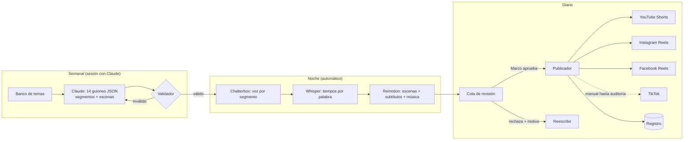
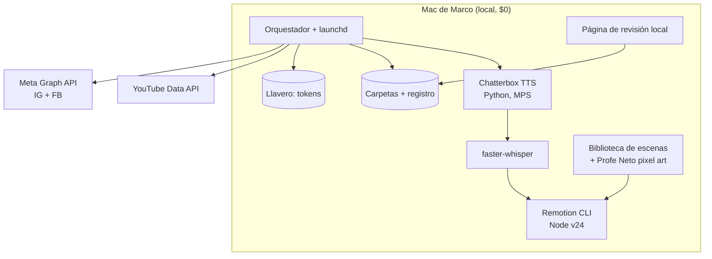

# Definición: Canal de idiomas ES↔EN en video corto

> Estado: **v4, motor cambiado a Remotion, para VoBo** · Fecha: 2026-11-23 · Product Owner: Marco

## Resumen ejecutivo

Un canal de videos cortos sin mostrar la cara, con un personaje **"profe directo y gracioso": Profe Neto**, dibujado en **pixel art**. Enseña inglés a hispanohablantes en una cuenta en español y español mexicano a angloparlantes en una cuenta en inglés. Publica **1 video diario por idioma** en TikTok, Instagram, Facebook y YouTube Shorts.

Los videos son **gráficos animados hechos con código (Remotion)**, inspirados en la referencia 4 (Curiosfer):
- Fondo de papel cálido.
- Tarjetas con profundidad.
- Avatar pixel art.
- Subtítulos arriba, que se revelan palabra por palabra.

No se usan clips de stock.

El sistema es local y con costo cero:
- Claude escribe los guiones y escenas en lote cada semana.
- Chatterbox pone la voz.
- Whisper sincroniza.
- Remotion renderiza.
- Marco aprueba el video final, en 15–30 min al día.
- Un publicador propio sube los videos con las APIs oficiales.

La monetización empieza con un PDF gratis ("Comenta GUIA") y una guía de pago.

## Objetivo de negocio

- Construir audiencia en dos mercados: Latam aprendiendo inglés (mercado grande) y EE. UU. aprendiendo español (mejor pago por vista).
- Monetizar en este orden:
  1. Producto digital propio y afiliados, desde el día 1.
  2. TikTok Creator Rewards (México es elegible según terceros, sin confirmar en la fuente oficial).
  3. Programa de socios de YouTube.
  4. Facebook, que es por invitación.
- Evitar la desmonetización por "contenido inauténtico o de plantilla" (política de YouTube del 16-jul-2026 y política de contenido no original de Meta). Lo que cuenta es el valor educativo real, un personaje consistente, la identidad visual propia y la variación de escenas y formatos.
- Sin metas de dinero comprometidas: la viralidad no se puede garantizar. El éxito de la fase 1 se mide con aprendizaje: qué formatos retienen audiencia.

**Roles:** Marco (Product Owner y aprobador diario) y Claude (guionista semanal y desarrollo del sistema).

## Alcance

### Incluye
- Guía de marca y personaje: tono, muletillas, reglas de humor y formatos de serie.
- **Identidad visual propia y biblioteca de escenas animadas** en Remotion: paleta, tipografía, Profe Neto en pixel art con varias poses, estilo de subtítulos y tipos de escena reutilizables.
- Banco de temas y calendario editorial bilingüe.
- Generación semanal de guiones con escenas (7 por idioma) en formato estructurado, con validación.
- Voz con Chatterbox (partida por idioma), sincronizada palabra por palabra con Whisper local.
- Render en lote con Remotion.
- Cola de revisión: Marco ve el video y lo aprueba o lo rechaza.
- Publicación automática en YouTube, Instagram y Facebook. TikTok se sube a mano mientras se aprueba su auditoría.
- Registro de qué se publicó, dónde y cuándo, con su estado.
- Lead magnet en PDF gratis, guía de pago en Gumroad y link en bio.
- Retirar MoneyPrinterTurbo cuando el render con Remotion esté funcionando.

### No incluye
- Mostrar la cara de Marco ni grabar su voz.
- Clips de stock o video generado con IA de pago.
- **Copiar la identidad de las referencias.** Se toman como inspiración (estructura, ritmo, tipo de subtítulo), pero paleta, personaje y marca son propios.
- Métricas avanzadas o dashboard (solo el registro de publicaciones). Se propone para una fase posterior.
- Responder comentarios de forma automática. El "Comenta GUIA" se atiende a mano o con link en bio.
- Nichos de finanzas, salud o temas legales.

## Historias de Usuario

### HU-1: Guía de marca y personaje
Como Product Owner, quiero una guía de personaje y estilo editorial, para que todos los guiones suenen a Profe Neto y no a IA genérica.

Criterios de aceptación:
- Dado el documento de guía, cuando se lee, entonces define: tono, 3–5 muletillas, temas prohibidos, 4–6 formatos de serie con estructura, y reglas de gancho (gancho en los primeros 2 s).
- Dado un guion cualquiera, cuando se compara con la guía, entonces se puede verificar si la cumple con una lista de chequeo objetiva.

### HU-2: Banco de temas y calendario bilingüe
Como Product Owner, quiero un banco de temas priorizado, para no quedarme sin ideas y alternar formatos.

Criterios de aceptación:
- Dado el banco, cuando se planea una semana, entonces hay al menos 30 temas listos por dirección (ES→EN y EN→ES), etiquetados por formato y nivel.
- Dado el calendario de una semana, cuando se revisa, entonces no hay dos videos seguidos del mismo formato en el mismo canal.

### HU-3: Identidad visual y biblioteca de escenas
Como Product Owner, quiero que los videos tengan una identidad visual propia inspirada en la referencia 4, para que se reconozcan al instante y parezcan hechos por una persona.

Criterios de aceptación:
- Dado el mini-ciclo de diseño, cuando se presenta, entonces incluye un **mockup de 3–4 fotogramas** con paleta, tipografía, Profe Neto y subtítulos, y **Marco lo aprueba antes de implementarlo**.
- Dado Profe Neto, cuando aparece en distintos videos, entonces es idéntico (dibujado con código, no generado al azar) y tiene al menos 4 poses (saludo, señalar, aprobar ✅, reprobar ❌).
- Dados los subtítulos, cuando se reproducen, entonces van en la parte superior y se revelan palabra por palabra en sincronía con la voz (la palabra actual resaltada, las siguientes atenuadas), con resaltado de la palabra clave.
- Dada la biblioteca, cuando se arma un guion, entonces hay al menos 6 tipos de escena propios del nicho. Por ejemplo: "frase incorrecta → corregida" (tacha y reemplaza), burbujas de chat en contexto, tarjeta de pronunciación, comparación ES vs EN, mini-quiz y cierre con CTA "Comenta GUIA".
- Dado el ritmo, cuando se ve un video, entonces algo cambia en pantalla con frecuencia. **El intervalo objetivo se calibra con Marco en el mockup** (la referencia 2 menciona ~0.3 s).
- Dados 7 videos de una semana, cuando se ven seguidos, entonces varían en escenas y estructura (no son plantilla idéntica).

### HU-4: Lote semanal de guiones con escenas
Como Product Owner, quiero que Claude genere cada semana 7 guiones por idioma con sus escenas, para que el render sea automático.

Criterios de aceptación:
- Dado un lote, cuando se valida, entonces cada guion trae: tema, formato, segmentos de narración etiquetados por idioma (`es`/`en`), una lista de escenas (tipo y datos) ligadas a los segmentos, el texto por plataforma y la duración estimada.
- Dado un guion, cuando se valida, entonces dura **entre 65 y 88 s**: TikTok Creator Rewards pide 1 minuto o más, y la API de Reels de Facebook acepta como máximo 90 s.
- Dado un segmento de narración, cuando se valida, entonces tiene **3 palabras o más**, porque Chatterbox falla con segmentos de una sola palabra.
- Dada una escena, cuando se valida, entonces su tipo existe en la biblioteca y sus datos cumplen el esquema de ese tipo.
- Dado un lote que no pasa la validación, cuando se intenta renderizar, entonces el sistema lo rechaza indicando el error, sin arreglarlo en silencio.

### HU-5: Render en lote (voz, sincronía y video)
Como Product Owner, quiero que los guiones se conviertan en videos sin intervención, para invertir mi tiempo solo en revisar.

Criterios de aceptación:
- Dado un guion válido, cuando se renderiza, entonces se genera la voz con Chatterbox por segmento, Whisper local obtiene el tiempo de cada palabra, y Remotion produce un MP4 vertical de 1080×1920 con escenas, subtítulos sincronizados y música libre de derechos.
- Dado un desfase entre la voz y los subtítulos, cuando se revisa, entonces no supera un umbral acordado (por ejemplo, 150 ms; a confirmar en el ticket).
- Dado un fallo (voz, alineación o render), cuando ocurre, entonces queda registrado con el motivo y el resto del lote continúa.
- Dado el lote semanal (14 videos), cuando corre de noche, entonces termina antes de la mañana siguiente.

### HU-6: Cola de revisión rápida
Como Product Owner, quiero ver cada video y aprobarlo o rechazarlo con un clic, para revisar todo en 15–30 min al día.

Criterios de aceptación:
- Dado un video renderizado, cuando entro a la cola, entonces lo puedo reproducir y ver el texto que se publicará en cada plataforma.
- Dado un video, cuando lo apruebo, entonces queda listo para publicarse. Cuando lo rechazo, puedo anotar el motivo y no se publica.
- Dado el uso diario, cuando reviso 2 videos, entonces me toma menos de 5 minutos.

### HU-7: Publicación automática
Como Product Owner, quiero que los videos aprobados se publiquen solos, para no subirlos a mano.

Criterios de aceptación:
- Dado un video aprobado, cuando llega su horario (**ES 19:00 CDMX, EN 18:00 hora del Este de EE. UU.**), entonces se publica en YouTube, Instagram y Facebook de su idioma con el texto de cada una. YouTube y Facebook se programan al subir (`publishAt` / `scheduled_publish_time`); Instagram necesita un cron local.
- Dado TikTok, **mientras no se apruebe la auditoría de la API**, cuando un video se aprueba, entonces el sistema deja listos el MP4 y el texto para que Marco lo suba a mano desde el celular (~1 min). La auditoría se solicita en paralelo. Si se publicara por API sin auditoría, quedaría privado para siempre.
- Dado un fallo en una plataforma, cuando ocurre, entonces las demás no se bloquean, el fallo queda registrado y se reintenta o se avisa.
- Dado el registro, cuando lo consulto, entonces veo por video el enlace o ID, la plataforma, la fecha y el estado.
- Dado el manejo de credenciales, cuando se guardan los tokens OAuth, entonces quedan fuera del código y fuera de git (Llavero de macOS o `.env` ignorado).

### HU-8: Embudo de monetización temprana
Como Product Owner, quiero un PDF gratis y una guía de pago enlazados en la bio, para generar ingresos antes de calificar a los anuncios.

Criterios de aceptación:
- Dado el lead magnet (por ejemplo, "100 frases que los nativos sí usan"), cuando alguien lo pide ("Comenta GUIA" o link en bio), entonces lo descarga gratis desde **Gumroad**.
- Dada la guía de pago (USD 5–15), cuando se publica, entonces existe en ES y en EN y se enlaza en la bio de las 8 cuentas.

### HU-9: Alta de cuentas y marca
Como Product Owner, quiero las 8 cuentas creadas con la misma identidad, para lanzar el canal.

Criterios de aceptación:
- Dadas las cuentas (4 plataformas × 2 idiomas), cuando se revisan, entonces comparten nombre o handle, foto (Profe Neto pixel art), bio y link en bio coherentes.
- Las cuentas de Instagram son de tipo Profesional y están vinculadas a una Página de Facebook (requisito de la API de publicación de Meta).

## Diseño técnico

| Decisión | Elección | Alternativa descartada y por qué |
|---|---|---|
| Motor de render | **Remotion** (React → MP4), render local con su CLI. Gratis para personas y equipos de hasta 3, incluyendo uso comercial y automatización ([licencia](https://www.remotion.dev/docs/license)). Node v24 ya instalado | MoneyPrinterTurbo: solo pega clips de stock; no puede producir el estilo de las referencias. Se retira al tener el render funcionando |
| Visuales | Escenas propias en código (tarjetas, burbujas, tachado y reemplazo, quiz) más Profe Neto en pixel art definido como matriz o sprite en código | Clips de Pixabay: genéricos. SDXL para el personaje: no garantiza que sea idéntico en cada video |
| Sincronía | Whisper local (faster-whisper, modelo pequeño o mediano) con tiempos por palabra sobre el audio final. Como el texto se conoce, se alinea contra el guion | Tiempos estimados por número de caracteres: desfasados |
| Voz | **Chatterbox Multilingual local** (MIT), voz por defecto, **partida por idioma**, con segmentos de 3 palabras o más. ~10–15 min por video, así que el lote corre de noche | Edge TTS: el uso comercial sin Azure puede violar los términos de Microsoft. Kokoro/Piper: dos voces distintas y el español suena más robótico |
| Guiones | Claude en una sesión semanal produce JSON validado con un esquema (segmentos + escenas) | LLM gratis automático: menor calidad. Gemini gratis no funcionó |
| Publicación | **Publicador propio** con APIs oficiales: YouTube Data API v3 y Meta Graph API (IG y FB). TikTok a mano hasta la auditoría | Upload-Post: su plan gratis da 10 subidas al mes y no incluye TikTok |
| Orquestación | Python (voz y Whisper) + Node (Remotion) en la Mac, con tareas programadas por `launchd` | Nube gratis: los videos son pesados y las credenciales tendrían que vivir en la nube |
| Estado | Carpetas (`guiones/`, `audio/`, `render/`, `aprobados/`, `publicados/`) y un registro JSON o SQLite | Una base de datos server: es más de lo que necesita una sola persona |
| Revisión | Página web local mínima: reproductor y botones de aprobar o rechazar | Revisar en Finder: no deja aprobar ni anotar el motivo del rechazo |
| Español enseñado | **Mexicano** | Neutro |
| Tienda | **Gumroad** | Hotmart y Payhip |
| Música | YouTube Audio Library o Pixabay Music (libres de derechos), con la licencia guardada | Música sin licencia clara |
| Seguridad | Tokens OAuth en el Llavero de macOS o `.env` en `.gitignore`. Servicios locales solo en `127.0.0.1` | — |

**Restricción conocida:** YouTube y Facebook se programan al subir. **Instagram necesita la Mac encendida a las 19:00 CDMX y a las 17:00 CDMX (18:00 hora del Este).**

## Diagramas

El flujo completo. Lo único que hace Marco a diario es aprobar o rechazar, y subir TikTok a mano mientras dura la auditoría.

Todo corre en la Mac. Las únicas dependencias externas son las APIs de publicación.

## Riesgos y decisiones

**Resuelto (2026-11-23)**
| Tema | Resolución | Fuente |
|---|---|---|
| Nombre del personaje | **Profe Neto** | PO |
| Aspecto | **Pixel art**, look inspirado en la referencia 4 (Curiosfer) | PO tras ver las referencias |
| Motor de render | **Remotion**: las referencias son gráficos animados hechos con código y MPT no puede producirlos | PO + análisis de las 4 referencias |
| Licencia de Remotion | Gratis para personas y equipos de hasta 3, con uso comercial y automatización permitidos | remotion.dev/docs/license |
| Español enseñado | Mexicano | PO |
| Tienda | Gumroad | PO |
| Horario | ES 19:00 CDMX · EN 18:00 hora del Este de EE. UU. | PO |
| TikTok sin auditoría | Subida manual mientras se aprueba | PO + docs de TikTok |
| Edge TTS | Descartado por la licencia comercial | Microsoft Q&A |
| Voz | Chatterbox, partida por idioma, voz por defecto | PO tras escuchar las muestras |
| Duración | 65–88 s | Docs de Meta y TikTok |
| Upload-Post | Descartado (plan gratis insuficiente) | docs.upload-post.com |

**Riesgos vigentes**
- **R1 – Contenido inauténtico:** Marco solo revisa el video final. La mitigación es la guía de Profe Neto, la identidad visual propia, la variedad de escenas y el valor educativo.
- **R2 – Esfuerzo de la biblioteca de escenas:** es el trabajo más grande del proyecto. Si hay pocas escenas, los videos se ven repetitivos. Se mitiga empezando con 6 tipos de escena y sumando más según lo que retenga audiencia.
- **R3 – Parecido con la referencia 4:** inspirarse no es copiar. La paleta, el personaje y la marca deben ser propios. Se revisa en el mockup.
- **R4 – Tiempo de producción nocturno:** cada video lleva unos 10–15 min de voz, más Whisper y el render de Remotion. Hay que medirlo en el primer ticket de render.
- **R5 – Auditoría de TikTok:** puede tardar o ser rechazada. Mientras tanto, se sube a mano.
- **R6 – APIs:** Meta pide una app, IG Profesional vinculado a una Página y permisos aprobados. En YouTube hay que confirmar en la práctica cómo publica un proyecto sin verificar.
- **R7 – Mac encendida** a las horas en que publica Instagram.
- **R8 – Disco:** ~26 GB libres. Chatterbox ocupa ~3 GB y Whisper ~0.5–1.5 GB. Al retirar MPT se liberan ~2.7 GB. Hace falta una regla de limpieza de videos tras publicar.
- **R9 – Cifras de monetización y países elegibles:** vienen de fuentes de terceros, sin verificar.
- **R10 – Voz clonada:** no aplica (voz por defecto). Si algún día se clona una voz, tiene que ser la de Marco o una con licencia.

**Preguntas abiertas**
- Ninguna que bloquee. El intervalo de ritmo y el umbral de sincronía se calibran con Marco en el mockup (HU-3) y en el primer render (HU-5).

## Impacto estimado (tickets tentativos)

0. Bootstrap del proyecto `video-editor`: git, estructura de carpetas, `.gitignore` para secretos y base del proyecto Remotion.
1. HU-1 Guía de Profe Neto y HU-2 Banco de temas.
2. **HU-3 Identidad visual: mockup de 3–4 fotogramas para VoBo**, luego Profe Neto pixel art, subtítulos y 6 tipos de escena.
3. Servicio de voz: Chatterbox partido por idioma + Whisper con tiempos por palabra.
4. HU-4 Esquema JSON de guion y escenas, validador y primer lote.
5. HU-5 Orquestador de render en lote con Remotion, más música libre de derechos.
6. HU-6 Página local de revisión.
7. HU-9 Alta de las 8 cuentas y apps de desarrollador, con pasos manuales de Marco.
8. HU-7 Publicador: YouTube → Meta (IG y FB) → registro. TikTok a mano.
9. HU-8 Lead magnet, guía de pago y link en bio.
10. Retirar MoneyPrinterTurbo (contenedores, imagen y carpeta) cuando el ticket 5 esté funcionando.
